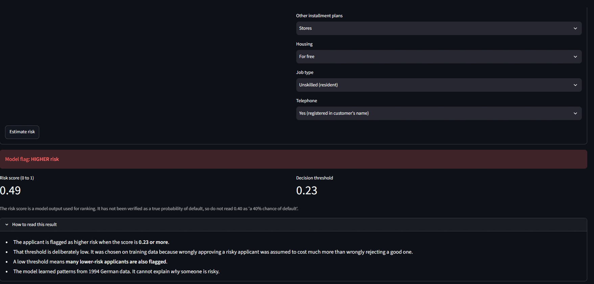
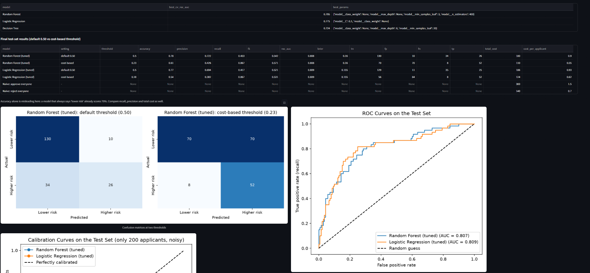
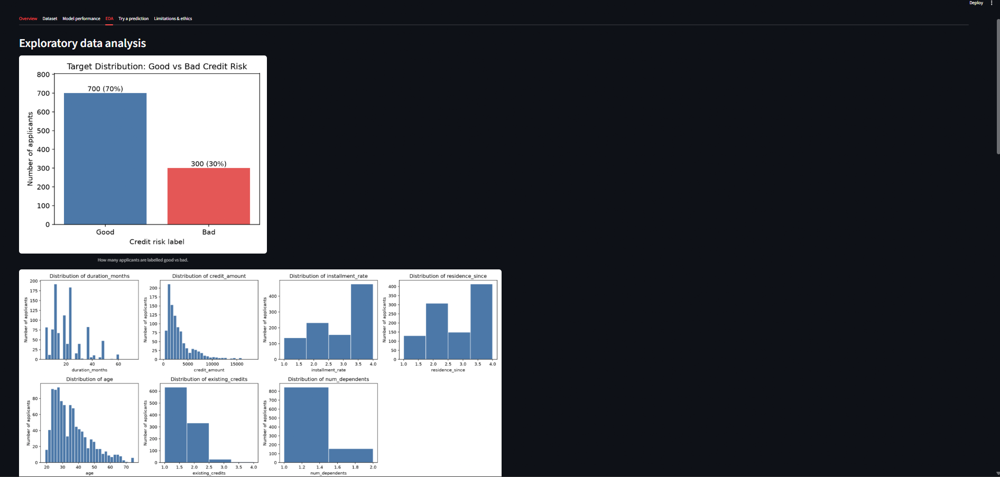

# Credit Risk Prediction System Using Machine Learning

An end-to-end machine learning project that estimates whether a loan applicant looks like a
**higher-risk** or **lower-risk** case, using the public German Credit dataset.

> **Educational decision-support project. This is NOT a real banking or loan-approval system.**
> Its output must never be the sole basis for an actual lending decision.

## Problem statement

Lenders want to identify applicants who are likely to be bad credit risks, but wrongly approving
a risky applicant usually costs more than wrongly rejecting a good one. This project:

1. builds a leakage-free preprocessing + model pipeline,
2. compares Logistic Regression, Decision Tree and Random Forest with cross-validation,
3. chooses a decision threshold using an explicit cost assumption,
4. evaluates the final model once on a held-out test set, and
5. serves the saved pipeline through a Streamlit dashboard.

## Dataset

- **Statlog (German Credit Data)**, UCI Machine Learning Repository
- Hofmann, H. (1994). DOI: [10.24432/C5NC77](https://doi.org/10.24432/C5NC77)
- License: CC BY 4.0 (attribution required)
- 1,000 applicants, 20 input attributes (7 numerical, 13 categorical), label 1 = good / 2 = bad
  (70% good, 30% bad)
- The label is a **credit risk label**. The dataset documentation does not define it as a verified
  default event.

The raw data is not stored in this repository. Download it with the command below.

## Technology stack

Python 3.12, pandas, NumPy, Matplotlib, Seaborn, scikit-learn, Streamlit, Joblib, pytest, Git.

## Project structure

```
credit-risk-prediction/
├── app.py                      # Streamlit dashboard
├── requirements.txt            # direct dependencies
├── requirements-lock.txt       # exact versions used for the reported results
├── pytest.ini
├── data/raw/                   # dataset is downloaded here (not committed)
├── models/
│   └── model_metadata.json     # threshold, feature ranges, test metrics (model file is not committed)
├── reports/
│   ├── *.csv, *.txt            # saved results
│   └── figures/                # EDA, evaluation and explainability charts
├── docs/screenshots/           # app screenshots
├── src/
│   ├── download_data.py        # downloads the dataset from UCI
│   ├── data_preprocessing.py   # loading, target, split, ColumnTransformer
│   ├── inspect_data.py         # first look at the data
│   ├── eda.py                  # EDA figures and tables
│   ├── train.py                # cross-validation and hyperparameter tuning
│   ├── evaluate.py             # final test evaluation, threshold, calibration
│   ├── explain.py              # permutation importance, coefficients, fairness audit
│   ├── save_model.py           # saves the final pipeline and metadata
│   ├── predict.py              # input validation and prediction
│   └── labels.py               # readable names for dataset codes
└── tests/                      # pytest unit tests (28 tests)
```

## Installation (Windows PowerShell)

```powershell
git clone https://github.com/<your-username>/credit-risk-prediction.git
cd credit-risk-prediction
py -3.12 -m venv .venv
.\.venv\Scripts\Activate.ps1
pip install -r requirements.txt
```

## How to train, evaluate and run

Run these from the project root, in this order:

```powershell
python -m src.download_data     # download the dataset into data/raw/
python -m src.inspect_data      # optional: first look at the data
python -m src.eda               # optional: EDA figures
python -m src.train             # cross-validation and tuning
python -m src.evaluate          # test-set evaluation and threshold selection
python -m src.explain           # feature importance and fairness audit
python -m src.save_model        # saves models/credit_risk_pipeline.joblib
streamlit run app.py            # launch the dashboard
python -m pytest -v             # run the tests
```

## Method summary

- **Split:** 80/20 stratified, fixed seed (`random_state=42`). Test set = 200 applicants.
- **No leakage:** preprocessing (median imputation, scaling, one-hot encoding) is inside a scikit-learn
  `Pipeline`, so it is fitted only on training data (and per fold during cross-validation).
- **Fairness decision:** `personal_status_sex` and `foreign_worker` are **not** model inputs.
  `age` is still used (see limitations).
- **Model selection rule (set before looking at the test set):** highest cross-validated ROC-AUC
  after tuning, which was Random Forest. Tuned Logistic Regression is reported as an interpretable reference.
- **Threshold:** chosen from out-of-fold predictions on the training set only, using a cost assumption
  of **false negative = 5, false positive = 1** (cost matrix described in the dataset's `german.doc`).

## Results (from actual runs)

Environment: Python 3.12.7, scikit-learn 1.9.1, pandas 3.1.0, run in October 2026.

### 5-fold cross-validation on the training set (default settings)

| Model | Accuracy | Precision | Recall | F1 | ROC-AUC |
|---|---|---|---|---|---|
| Random Forest | 0.761 | 0.662 | 0.400 | 0.497 | 0.790 |
| Random Forest (balanced) | 0.745 | 0.574 | 0.575 | 0.573 | 0.788 |
| Logistic Regression | 0.742 | 0.595 | 0.442 | 0.505 | 0.762 |
| Logistic Regression (balanced) | 0.684 | 0.479 | 0.671 | 0.558 | 0.760 |
| Decision Tree | 0.683 | 0.477 | 0.488 | 0.479 | 0.627 |
| Decision Tree (balanced) | 0.681 | 0.473 | 0.483 | 0.477 | 0.625 |
| Dummy (always "lower risk") | 0.700 | 0.000 | 0.000 | 0.000 | 0.500 |

After tuning (best CV ROC-AUC): Random Forest 0.795, Logistic Regression 0.775, Decision Tree 0.724.
Fold-to-fold standard deviation of ROC-AUC was about 0.04 for Random Forest and about 0.06 for
Logistic Regression, so the gap between those two is small.

### Final test set (200 applicants, 60 labelled higher risk)

| Model | Threshold | Accuracy | Precision | Recall | F1 | Missed risky (FN) | False alarms (FP) | Total cost |
|---|---|---|---|---|---|---|---|---|
| Random Forest (tuned) | 0.50 | 0.78 | 0.72 | 0.43 | 0.54 | 34 | 10 | 180 |
| **Random Forest (tuned)** | **0.23 (cost-based)** | 0.61 | 0.43 | 0.87 | 0.57 | 8 | 70 | **110** |
| Logistic Regression (tuned) | 0.50 | 0.77 | 0.69 | 0.42 | 0.52 | 35 | 11 | 186 |
| Logistic Regression (tuned) | 0.18 (cost-based) | 0.54 | 0.38 | 0.87 | 0.53 | 8 | 84 | 124 |
| Naive: approve everyone | - | - | - | - | - | 60 | 0 | 300 |
| Naive: reject everyone | - | - | - | - | - | 0 | 140 | 140 |

Test ROC-AUC was about 0.81 for both tuned models. Total cost = FP x 1 + FN x 5.

**How to read this honestly**

- At the default 0.50 threshold the model costs *more* than rejecting everyone (180 vs 140).
- At the cost-based threshold the Random Forest costs 110 vs 140 for "reject everyone", a modest gain on a
  small test set. Accuracy drops to 0.61 because 61% of applicants are flagged, so **accuracy is the wrong
  metric here**.
- Random Forest and Logistic Regression perform about the same on the test set. Differences this small
  on 200 applicants are within noise.

### What the model relies on

Permutation importance (test set, drop in ROC-AUC): `checking_account_status` is by far the strongest
(about 0.138), followed by `duration_months` (0.021), `credit_amount` (0.018) and `purpose` (0.014).
Lower-ranked features have error bars as large as their effect. This describes what the model uses,
**not what causes default.**

## Screenshots

| Prediction | Model performance | EDA |
|---|---|---|
|  |  |  |

## Limitations and ethical considerations

- **Educational only.** Not validated, audited or approved for real lending.
- **Old and small data.** 1,000 applicants from 1994. Today's applicants and economy differ.
- **Label, not confirmed default.** The target is a good/bad risk label.
- **Many false alarms by design.** The cost-based threshold flags 61% of test applicants.
- **Risk score, not probability.** The model output has not been verified as a calibrated probability
  (see `reports/figures/08_calibration_curves.png`, based on only 200 test applicants).
- **Cost assumption drives the threshold.** If the real costs differ, the best threshold changes.
- **Associations, not causes.** Some patterns are counter-intuitive (applicants with a "critical account /
  other credits" history show a lower bad rate), probably reflecting how the original data was collected.
- **Fairness.** Gender/marital status and foreign-worker status are excluded, but other features can act
  as proxies, and age is still used. The group-level audit (`reports/fairness_audit.csv`) uses very small
  groups, so it proves neither fairness nor bias. Younger applicants were flagged more often and had a
  higher false-positive rate in the test split, but the sample is too small to draw conclusions.
- **Privacy.** Real applicant data is sensitive. This project uses a public dataset, and the app stores nothing.

## Future improvements

- Repeated cross-validation or bootstrap confidence intervals for all metrics
- Probability calibration (Platt or isotonic) with a larger dataset
- Compare a version without `age`, and a larger fairness audit
- Test on a more recent public credit dataset
- Containerised deployment and CI that runs the tests

## License and attribution

Code: MIT License (see `LICENSE`).
Dataset: Hofmann, H. (1994). Statlog (German Credit Data). UCI Machine Learning Repository,
https://doi.org/10.24432/C5NC77, licensed CC BY 4.0.